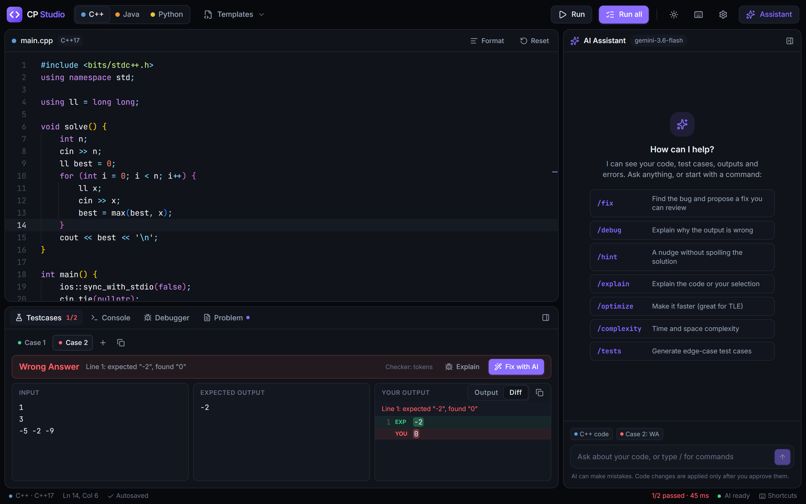
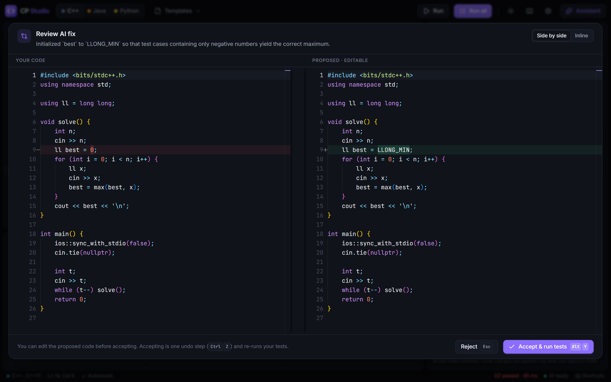
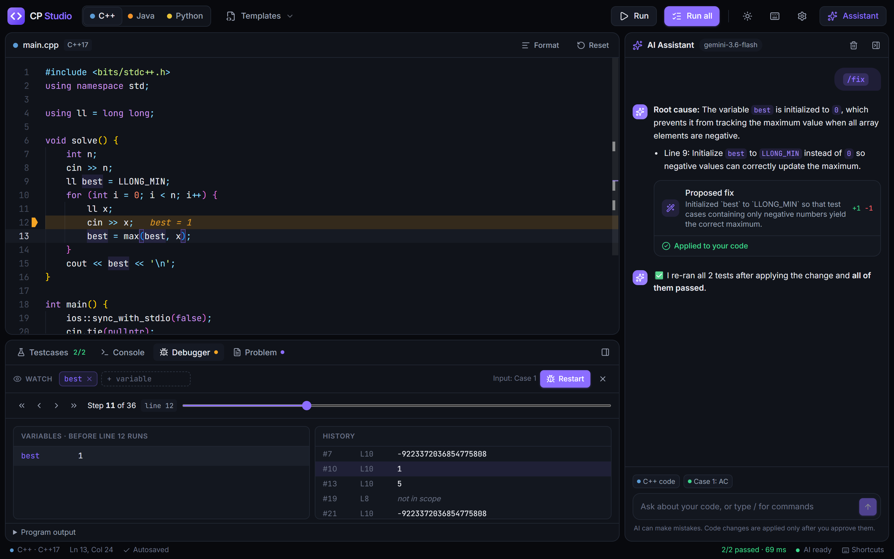
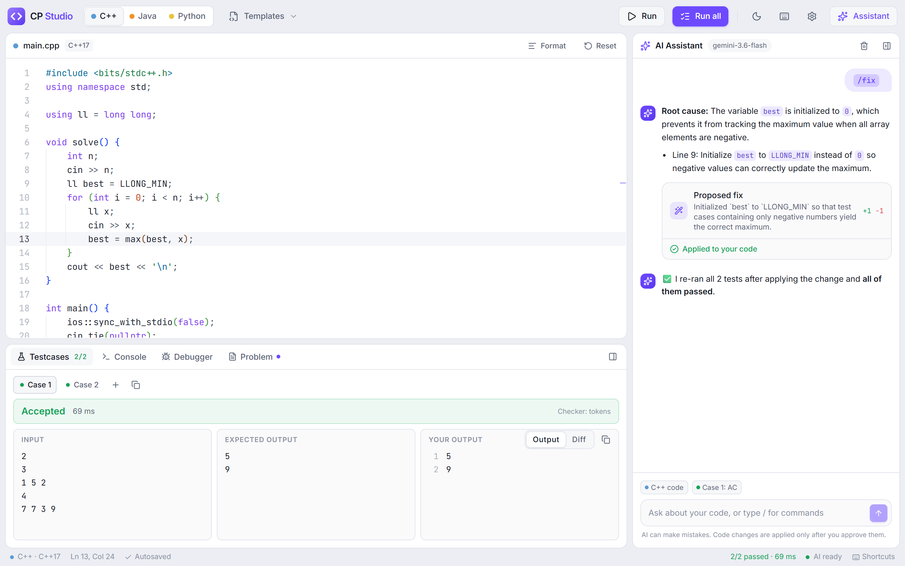

<div align="center">


# CP Studio

**An online practice editor for competitive programming in C++, Java and Python.**<br />
Run code against test cases like an online judge, step through it with a debugger, and get help from an AI assistant. The assistant changes your code only after you approve.




</div>

## Features

The home page (`/`) is the **practice sheet**. The **Home** · **Contests** · **Resources** · **History** · **Profile** tabs and **Open editor** (`/editor`) link everything.

### Practice sheet
**Home** (`/`, also **Sheet** in the editor's top bar) is a topic-wise roadmap of 272 Codeforces problems rated 1100–1800, in 22 steps from arrays to graphs, easy to hard within each step.
- **Solve** opens the problem in CP Studio's editor, in its own tab with the rating, topics and the sheet's hint (behind a spoiler). With the CP Studio helper installed, the statement and samples arrive by themselves; otherwise the Problem tab shows the one-click **Send to CP Studio** bookmark. **Codeforces ↗** opens the problem on Codeforces.
- Track each problem as **To do**, **Attempted**, **Solved** or **Revisit**, star it, and keep a note. Signed in, problems Codeforces accepted (from your linked profile) and problems whose samples all passed here count as solved by themselves.
- A LeetCode-style progress chart (one ring split into Easy / Medium / Hard, with each level's count; hover a level for its share), **Up next** (the first unsolved problem), search and filters by rating, level and status, an **All problems** view sorted by rating, and **Pick for me** for a random unsolved one. Progress is saved in the browser, and to your account when signed in.

### Contests
**Contests** (`/contests`) lists upcoming and running contests on Codeforces, CodeChef, LeetCode and AtCoder for the next five weeks, by day in your time zone. The next round gets a live countdown; week-long contests sit under **Running now**. Filter by judge (remembered), open a contest, or **Add to calendar** (Google Calendar, or an `.ics` file with a 15-minute reminder). The server reads Codeforces’ and LeetCode’s APIs, CodeChef’s contest list and AtCoder’s contests page, caches each for 30 minutes, and says which judge couldn’t be reached instead of failing.

### Resources
**Resources** (`/resources`) is a curated list of well-known places to learn and practice (USACO Guide, CP-Algorithms, CSES, Codeforces EDU, AtCoder’s DP contest, KACTL, YouTube channels, tools like Competitive Companion and Carrot), by category and level, with search.

### Import problems
- **Fetch a problem by its number or URL:**
  - **CodeChef:** `FLOW001`
  - **LeetCode:** `1` or `two-sum`
  - **AtCoder:** `abc300_a`

  You get the statement, with math typeset (KaTeX) as on the judge's site, plus the sample tests and the time limit. An import can be undone.
- **Submit on Codeforces / CodeChef / LeetCode / AtCoder** copies your code (for LeetCode, just the `Solution` class) and opens the judge's submit page with the problem selected.
- **Auto-fill on the judge:** with the optional CP Studio helper (a userscript for Tampermonkey or Violentmonkey, installed once from **Auto-fill** next to the Submit button), the judge's page opens with your code already in its editor and the language picked. It keeps the compiler you chose there before (otherwise the newest G++, Java 21, or PyPy 3). You still press Submit yourself. The code travels in the link's `#fragment`, which never reaches a server, and the helper only accepts it from CP Studio. Since version 1.1 it also brings Codeforces statements in when you press **Solve** on the practice sheet.
- The sample tests appear under the statement as **Input / Output** cards with copy buttons. They are also loaded as your test cases, and **Use as test cases** puts them back after you've changed them.
- **Codeforces** blocks automated downloads, so a one-click **Send to CP Studio** bookmark reads the problem from the page you have open.
- **LeetCode** problems are methods rather than programs. Importing one opens a tab (e.g. `two-sum.cpp`) in each language holding only the `Solution` class, like on LeetCode (and the AI sees just that). The driver that reads each test and prints the answer in LeetCode's format is added when the code runs or is debugged, and errors still point at the right lines; the Problem settings can show it in the tab instead, built from LeetCode's own type information (no AI needed). Design problems such as `LRUCache` get an AI-written `main()` via **Starter + main()**.

### Run like a judge
- **Multiple test cases**, each with an input, an expected output and your output, plus verdicts: **Accepted**, **Wrong Answer**, **Time Limit Exceeded**, **Runtime Error** and **Compilation Error**.
  - Each case shows its verdict as a coloured dot, and one verdict line explains the first difference.
  - Drag the dividers to resize the Input / Expected / Output columns. Change their text size from the **⋯** menu, in Settings, or with `Ctrl` + mouse wheel over them.
  - Quick actions: copy, clear, and use your output as the expected output.
  - Reset options: restore the problem's samples, clear results, or delete all cases. Each can be undone.
- **Judge-style output checking:**
  - Two modes: word by word (like Codeforces) or exact lines.
  - Optional decimal tolerance (`1e-6` / `1e-9`).
  - Optional "ignore letter case" for YES/NO answers.
- **Clear wrong answers.** The checker tells you exactly what's wrong, e.g. `Line 2: expected "9", found "3"`, and a **Diff** view highlights the differing words.
- **Readable crashes.** Runtime errors are explained ("Segmentation fault", "Integer division by zero"). Compiler errors become clickable links and squiggles in the editor.
- **Fast re-runs.** Code is compiled once per change, so re-running tests is instant.

### Accounts
- **Sign up** with email and password, or **Continue with Google / GitHub** when those are configured. Sessions are httpOnly cookies, stored in Postgres (e.g. Neon) by [Better Auth](https://www.better-auth.com/).
- The editor, running and debugging work without an account. **The AI assistant needs one**, which keeps the shared Gemini quota for people who signed up.
- Accounts turn on when `DATABASE_URL` is set; the tables are created on first start.
- **Your work follows you:** signed in, your tabs, tests, saved templates and settings are saved to your account as you type and load on any device. Code written before signing up moves into the new account. Signing out leaves this browser with a fresh workspace.
- **Profile** (`/profile`, the Profile tab or the account menu) has two tabs. **Overview:** your **coding streak** (days in a row you ran code) and **solving streak** (days you solved a problem), with the longest of each; problems solved; **practice sessions** (coding with no problem loaded); a year-long activity heatmap; solved and opened per judge; runs per language; recent problems. Days follow your own time zone.
- **Judge profiles** (on your profile): link your Codeforces, LeetCode, CodeChef and AtCoder usernames and the judges' accepted solutions count too: in **Problems solved**, the heatmap and your streaks, with ratings, ranks and LeetCode's Easy / Medium / Hard split. Only public profile data is read: Codeforces through its official API, AtCoder through AtCoder Problems, LeetCode through its public profile, CodeChef from the profile page (totals only). Profiles refresh every 6 hours when you open your profile, or with **Sync now**. Problems the judge accepted show as **Accepted** in History.
- **Stats** (the second tab of Profile, `/profile?tab=stats`): a **rating graph** for each linked judge (every rated contest, the peak marked, hover for the contest), current and best rating, Codeforces rank and LeetCode's global standing; LeetCode's **Easy / Medium / Hard** donut; Codeforces problems solved **per problem rating**; and problems solved **per topic** (Codeforces tags, LeetCode topics).
- **History** (account menu, or the History tab): every problem you opened, with **Solved** (all sample tests passed), **Attempted** and **Submitted**, the judge, languages and when. Search, filter, and click one to reopen it with your tests and the code you wrote.

### AI assistant (Google Gemini)
- It sees your code, your selection, the problem statement, your test cases, their outputs and any errors.
- **`/fix`** proposes a fix as a **side-by-side diff**. Nothing changes until you accept. Accepting is one `Ctrl+Z` undo step and automatically re-runs all your tests.
- **Generate tests** (`Alt+G`): edge, random or mixed cases, written to fit your code's input format. Expected outputs are worked out from the problem statement. Pick which ones to add, and they run straight away.
- `/debug`, `/hint` (no spoilers), `/explain`, `/optimize`, `/complexity`.
- It stays on topic: it only answers questions about data structures, algorithms and your code.
- **Several API keys:**
  - Requests rotate through every key in `GEMINI_API_KEYS`.
  - A key that runs out of quota rests until the quota refills: for a per-minute limit, the delay Gemini asks for; for the daily limit, midnight Pacific time. Meanwhile the other keys take over.
  - When every key is out on the main model, it falls back to the Flash-Lite models, which have far higher free limits.
  - Gemini counts quota per Google Cloud project, so create each key in its own project.
- **Lean on tokens:**
  - Only failing tests and the selected test are sent in full; long inputs and outputs keep their beginning and end.
  - Earlier chat turns are trimmed, and `/explain` and `/complexity` skip test data entirely.
  - Token use for each request is logged on the server.

### Debugger
- Select a variable and click **Debug**. The program runs on the selected test case and every line is recorded.
- Step forward and back, or scrub a timeline. The current line is highlighted, with the variable values shown next to it.
- Each variable's full history of changes is listed. Runtime errors are pinpointed to their line.
- Engines: **gdb** for C++, **JDI** for Java and **sys.settrace** for Python.

### Editor
- The **Monaco** editor (the editor behind VS Code).
- **Themes, set separately for the app and the editor:**
  - **App:** GitHub Dark (the default) or GitHub Light.
  - **Editor** (the code editor and the test case panel): any of 14 themes. Dark: GitHub Dark, Ember, Midnight, One Dark, Dracula, Tokyo Night, Nord, Monokai, Gruvbox, Catppuccin Mocha. Light: GitHub Light, Daylight, Solarized Light, Catppuccin Latte. Dark and light mode each remember their own editor theme.

  `Alt+T` switches the app between dark and light, and the editor to the theme you chose for that mode.
- **Easy on the eyes:** Darkness and Contrast sliders (Settings) adjust the editor and test case panel; the rest of the app keeps GitHub's colors.
- **Where:** the app's Dark / Light is in your profile menu (and Settings, and `Alt+T`); **Settings** (the gear in the editor's header) picks the editor theme.
- **Tabs:** keep several files per language, e.g. a solution and a brute force.
  - **+** adds a tab from any template, or duplicates the current one.
  - Double-click a tab to rename it. Closing a tab can be undone.
  - Run, the debugger and the AI always act on the active tab.
- **Autocomplete** for keywords, STL / Java / Python library members, identifiers in your file, and CP snippets: `fori`, `readv`, `bfs`, `dfs`, `dsu`, `binsearch`, `modpow`, `sieve`, `graph`…
- **Formatting** with clang-format (C++/Java) and Ruff (Python). Both run in the browser as WebAssembly.
- **CP templates** (multi-test, fast I/O, blank) and your own saved templates, plus **Reset** to start over. Reset can be undone.
- **Download** the active tab as a file, or all your tabs as a `.zip`.
- **Save to GitHub**: sign in with your own GitHub account and commit solutions to your repository (e.g. `codeforces/1904A.cpp`); the repository is created on first save.
- Resizable panels, with the test panel **below or beside** the editor. Your work is saved in the browser automatically.
- **Timer** in the top bar: a stopwatch, or a countdown (15 min to 2 h, or any length) that warns when 5 minutes are left, beeps when time is up and then counts overtime. It can start by itself when you import a problem.
- **Full screen** (`Alt+Enter`), and **editor only** (`Alt+Z` or the button above the editor): just the code, filling the screen; Esc brings the rest back.
- **Reset layout** (test panel ⋯ menu or Settings → Layout) puts panel sizes, the test panel and the top bar back to their defaults.
- **Lock layout** (`Alt+K` or the lock button) so panels can't be resized, moved or hidden by accident while you code.
- **Keyboard shortcuts** for everything.

<table>
  <tr>
    <td></td>
    <td></td>
  </tr>
  <tr>
    <td align="center"><b>Review AI fixes as a diff</b></td>
    <td align="center"><b>Step through your code</b></td>
  </tr>
  <tr>
    <td colspan="2"></td>
  </tr>
  <tr>
    <td colspan="2" align="center"><b>Light theme</b></td>
  </tr>
</table>

## Getting started

### Prerequisites
- **Node.js 20.19+**
- The toolchains for the languages you want to run:

| Language | Windows | Linux / macOS |
|---|---|---|
| C++ (+ debugger) | g++ and gdb from [MSYS2](https://www.msys2.org/) or [WinLibs](https://winlibs.com/) | `g++`, `gdb` |
| Java | JDK 17+ (e.g. [Temurin](https://adoptium.net/)) | `openjdk-17-jdk` |
| Python | [Python 3.10+](https://www.python.org/downloads/) | `python3` |

If a toolchain is missing, the app shows a ⚠ next to that language.

### Run locally

```bash
git clone https://github.com/rajveer-09/cp-studio.git
cd cp-studio
npm install
cp server/.env.example server/.env   # add your GEMINI_API_KEYS
npm run dev
```

Open **http://localhost:5173**. The API server runs on port 3001.

Get a free Gemini API key from [Google AI Studio](https://aistudio.google.com/apikey). Without a key, everything except the assistant still works.

## Keyboard shortcuts

| Shortcut | Action |
|---|---|
| `Ctrl+Enter` | Run the selected test case |
| `Ctrl+Shift+Enter` | Run all test cases |
| `Alt+N` | Add a test case |
| `Alt+G` | Generate test cases with AI |
| `Shift+Alt+F` | Format code |
| `Alt+W` / `F8` | Debug the variable at the cursor / restart debugging |
| `Alt+.` / `Alt+,` | Next / previous debugger step |
| `Ctrl+Shift+A` | Focus the AI assistant |
| `Alt+Y` / `Esc` | Accept / reject a proposed fix |
| `Alt+1` `Alt+2` `Alt+3` | Switch to C++ / Java / Python |
| `Alt+L` | Move the test panel right / bottom |
| `Alt+B` | Show / hide the AI assistant |
| `Alt+K` | Lock / unlock the layout |
| `Alt+H` | Hide / show the top bar |
| `Alt+Enter` | Full screen |
| `Alt+Z` | Editor only, full screen |
| `Alt+T` | Switch the app between dark and light |
| `Alt+/` | Show all shortcuts |

On macOS, use `⌘` instead of `Ctrl`.

## Configuration

Set these in `server/.env` locally, or as environment variables when deploying.

| Variable | Default | Purpose |
|---|---|---|
| `GEMINI_API_KEYS` | (empty) | One or more Gemini API keys, comma-separated. Turns on the AI assistant |
| `GEMINI_MODEL` | `gemini-3.6-flash` | Main Gemini model |
| `GEMINI_FALLBACK_MODELS` | `gemini-3.5-flash-lite,gemini-3.1-flash-lite` | Used in order when every key is out of quota on the main model |
| `DATABASE_URL` | (empty) | Postgres connection string (e.g. Neon). Turns on accounts |
| `BETTER_AUTH_SECRET` | (empty) | Signs session cookies. Required for accounts in production; changing it signs everyone out |
| `GOOGLE_CLIENT_ID` `GOOGLE_CLIENT_SECRET` | (empty) | **Continue with Google**. Redirect URI: `https://YOUR-SITE/api/auth/callback/google` |
| `GITHUB_CLIENT_ID` `GITHUB_CLIENT_SECRET` | (empty) | One GitHub OAuth App for **Continue with GitHub** and **Save to GitHub**. Callback URL: `https://YOUR-SITE/api/` |
| `ACCESS_KEY` | (empty) | Optional shared password that visitors enter once |
| `PUBLIC_URL` | (from requests) | The site's address, used in sign-in callbacks and the submit helper. Only needed behind unusual proxies |
| `PORT` | `3001` | HTTP port |
| `TRUST_PROXY` | `1` in Docker | Set behind a reverse proxy, so rate limits see real IPs |
| `CXX` `JAVAC` `JAVA` `PYTHON` `GDB` | `g++` `javac` `java` `python3` `gdb` | Toolchain commands |
| `MAX_CONCURRENT_RUNS` | the CPU the container may use (1 on a 0.1-CPU instance) | Programs compiled or run at the same time |
| `CXX_PCH_DIR` | `/opt/cp-pch` in Docker | Precompiled `<bits/stdc++.h>`, which makes C++17 compiles about 3× faster |

## Deployment

The `Dockerfile` builds one image with the app, g++, gdb, Java 17 and Python 3. It runs anywhere Docker does:

```bash
docker build -t cp-studio .
docker run -p 3001:3001 -e GEMINI_API_KEYS=key1,key2 -e ACCESS_KEY=choose-a-password cp-studio
```

**On Render:**
1. Create a **Web Service** from this repo.
2. Choose the **Docker** runtime.
3. Add `GEMINI_API_KEYS`, `GEMINI_MODEL`, `DATABASE_URL` and `BETTER_AUTH_SECRET` as environment variables (plus the Google / GitHub ones for those sign-in buttons).

The port is picked up automatically. Render's free instance is small (about 0.1 CPU, 512 MB RAM) and sleeps when idle, so compiling is slow there. Java in particular needs a paid instance or a VM.

Secrets are never part of the image: `.env` files are excluded from the Docker build.

## How it works

```
client/   React + Vite + Tailwind
          Monaco editor, test panel, output checker, debugger UI, AI assistant
server/   Express + TypeScript
          /api/run    compile once, run every test with time and output limits
          /api/debug     record variables line by line (gdb · JDI · sys.settrace)
          /api/problems  import statements and samples from CodeChef, LeetCode, AtCoder
          /api/ai/*      Gemini chat (streamed), structured fixes, test generation, LeetCode drivers
```

- Compiled programs are cached by a hash of the code, so "Run all" compiles once.
- The output checker runs in the browser. Changing an expected output or a checker setting updates the verdict immediately.
- The Gemini key stays on the server. User programs run with a minimal environment, so they can't read it.

## Security

CP Studio is meant for **trusted users**. Submitted code runs on the server without a sandbox. These safeguards are in place:

- time, output and request-size limits
- a cap on how many programs run at once
- per-IP rate limits
- an optional shared access key

Always set `ACCESS_KEY` on a public deployment.

## Author

**Rajveer Sharma**

@CP Studio
